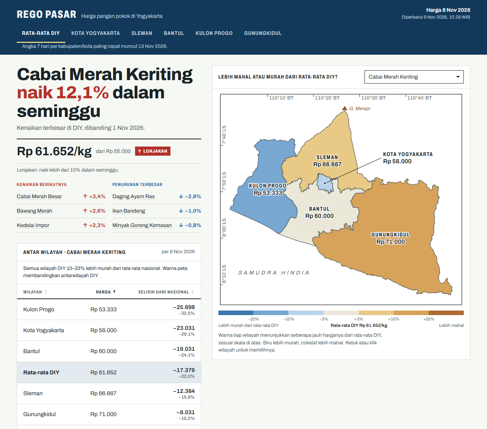
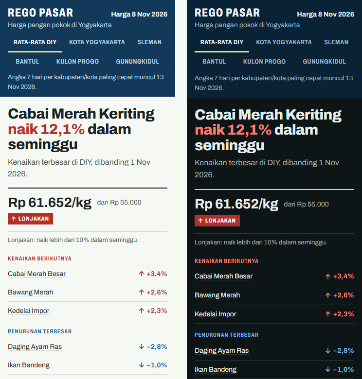

# Rego Pasar

**Staple food prices in Yogyakarta (DIY), read like a map.**

Rego Pasar ("market price" in Javanese) turns the government's daily price tables into one clear page. It answers a single question: which staples are getting more expensive in Yogyakarta, in which regency, and by how much?

It covers 23 staples for the DIY provincial average and its five regencies: Kota Yogyakarta, Sleman, Bantul, Kulon Progo and Gunungkidul. Each is benchmarked against the national average and refreshed automatically every morning from [Panel Harga Pangan](https://panelharga.badanpangan.go.id/) (Badan Pangan Nasional).

> **Ringkasan:** Rego Pasar menampilkan harga eceran 23 bahan pangan pokok di DIY: rata-rata provinsi, lima kabupaten/kota, dan pembanding nasional. Datanya diambil otomatis tiap pagi dari Panel Harga Pangan (Bapanas). Rego Pasar bukan sumber harga resmi.



<p align="center"></p>

## What it does

- **Answer first.** The page opens with the week's biggest rise, for example "Cabai Merah Keriting naik 12,1% dalam seminggu". It shows the price it is measured from and flags a spike when a price rises more than 10% in 7 days. The three next rises and the three biggest falls follow.
- **The map is the region picker.** Real regency boundaries are tinted on a seven-step scale by how far each regency's price sits from the DIY average: blue cheaper, sand to brown dearer. Click or tap a regency to select it.
- **Region comparison.** Every regency against the national average, in rupiah and percent, sortable.
- **All 23 staples.** The list is filtered by category and sortable by name, price, 7-day change or difference from national.
- **Price profile.** A 7, 30 or 90-day trend drawn as an elevation profile, with the "acuan 7 hari" point that the headline change is measured from. You can read it by hover, tap, or arrow keys.
- **Honest about gaps.** A missing price is shown as "tidak ada data", never estimated. Where a regency's history is still too short, the page says so and names the DIY figure it uses instead.

## Data

| | |
| --- | --- |
| Source | Panel Harga Pangan, Badan Pangan Nasional. Consumer (retail) level. |
| Coverage | DIY average, 5 regencies/cities, national average; 23 commodities in 5 categories |
| Update | Daily at 06:00 WIB. The page shows the previous day's final prices. |
| History | DIY average from 9 Aug 2026. Regencies and national from 6 Nov 2026: the source keeps only today and yesterday for those, so their history builds up one day at a time. |

Data handling rules:

- Prices are stored as integer rupiah, dates as `YYYY-MM-DD` in WIB, and missing values as `null`.
- Only the source's previous-day figure is used. The current day's numbers are still being revised while the day is open.
- Raw responses are kept untouched in `data/raw/`. If a fetch fails or the output fails validation, the last good `data/processed/` stays in place.
- Fetching is polite: a project User-Agent, at least 1 second between requests, `robots.txt` respected, and only endpoints that need no login or key.

**Verification:** 10 prices picked at random from the page were checked against fresh source requests for the same date, and all 10 matched. See [docs/verification.md](docs/verification.md).

> Rego Pasar is not an official price source. Check the original source before making decisions.

## How it works

```
Panel Harga Pangan (open JSON endpoints)
        │  scraper/fetch.py      polite requests, raw responses saved as-is
        ▼
data/raw/                        one file per region or commodity per day
        │  scraper/normalize.py  names and units from config, 0 → null
        │  scraper/build.py      7-day change, spike flag, validation
        ▼
data/processed/                  latest.json, meta.json, history/<commodity>.json
        │  web/ (Vite)           static page reads the JSON at runtime
        ▼
Static site                      GitHub Actions, daily at 06:00 WIB
```

The 7-day change is `(today − 7 days ago) ÷ 7 days ago × 100`, rounded to one decimal. If the day 7 days back is missing, the nearest earlier day within 3 days is used; otherwise the value is `null`. The calculations are pure functions covered by `pytest`.

## Tech

- **Pipeline:** Python 3.13, standard-library `urllib`, PyYAML, pytest, ruff.
- **Page:** TypeScript (strict, no `any`) and Vite.
  - The map and the price profile are hand-drawn SVG; no chart or map library.
  - Archivo variable font with a metric-matched fallback, so the page does not shift when the font loads.
- **Automation:** a GitHub Actions workflow tests, fetches, validates and commits the day's data. It can also publish the page to GitHub Pages.
- **Design:** built with the Impeccable design workflow; the direction is a topographic map sheet. See [DESIGN.md](DESIGN.md) and [design/DECISION.md](design/DECISION.md).

**Accessibility:**
- Rises and falls always carry an arrow as well as a colour.
- Keyboard focus is kept across every redraw.
- Each action is announced to screen readers.
- The trend chart is a slider that reads out date and price.
- Light and dark themes follow the device.
- The layout works at 360 px with no horizontal scrolling.

## Run it locally

Requirements: Python 3.13 and Node.js 22.

```bash
# data pipeline (from scraper/)
python -m venv .venv
.venv\Scripts\activate          # Windows; on macOS/Linux: source .venv/bin/activate
pip install -r requirements.txt
pytest
python fetch.py --days 1        # fetch the latest day (raw files already present are skipped)
python build.py                 # validate and write data/processed/

# page (from web/)
npm install
npm run dev                     # http://localhost:5173
npm run build                   # static output in web/dist/
```

The repository already contains the collected data, so `npm run dev` works without fetching anything.

## Project structure

```
scraper/      fetch.py, normalize.py, build.py, config/ (commodities, categories, regions), tests/
data/raw/     source responses by date (never edited by hand)
data/processed/  JSON the page reads
web/          index.html, src/ (main.ts, map.ts, chart.ts, format.ts, style.css)
docs/         PRD.md, data-sources.md, verification.md
design/       mockups and the design decision
.github/workflows/update-data.yml   daily update and publish
```

## Publishing

Publishing to GitHub Pages is currently switched off; the daily data update still runs. To publish again:

1. In the repository settings, set Pages to the source "GitHub Actions".
2. Add the Actions variable `PUBLISH_PAGES` with the value `true`.

## Credits

- **Price data:** [Panel Harga Pangan](https://panelharga.badanpangan.go.id/), Badan Pangan Nasional.
- **Regency boundaries:** [geoBoundaries](https://www.geoboundaries.org/) (BPS, WFP, OCHA ROAP), CC BY 3.0 IGO.
- **Typeface:** [Archivo](https://fonts.google.com/specimen/Archivo) by Omnibus-Type, SIL Open Font License, via Fontsource.

## License

The code is released under the [MIT License](LICENSE). The licence covers this project's own code and documents only. The price data belongs to Badan Pangan Nasional. The regency boundaries are CC BY 3.0 IGO and Archivo is under the SIL Open Font License, as credited above.
